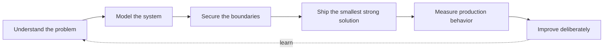

<div align="center">



[](https://keshavs.in)
[](https://www.linkedin.com/in/keshavsandhu)
[](mailto:keshavsandhu.me@gmail.com)

[](https://git.io/typing-svg)

</div>

## Hello - I'm Keshav

I'm a **Full-Stack Software Engineer with nearly 3 years of experience** building secure, scalable SaaS platforms and AI-enabled products. My core stack is **TypeScript, React/Next.js, Node.js, PostgreSQL, Redis, AWS, and Generative AI**.

I enjoy owning systems end to end: clarifying the product problem, shaping the architecture, designing tenant-aware APIs and data models, building accessible interfaces, deploying reliably, and measuring what improves in production.

```text
Current focus  Multi-tenant B2B SaaS, platform performance, secure APIs, and applied AI
Working toward Platform architecture and technical leadership
Based in       Noida, India
Open to        Product-focused full-time roles and thoughtful collaborations
```

## Impact in production

| Scale | Performance | Automation | Product delivery |
| :--- | :--- | :--- | :--- |
| Designed data and service boundaries for **50+ organizations** | Cut average API response times by **~40%** | Reduced manual compliance follow-ups by **~60%** | Shipped **4 cross-tenant dashboards** |
| Supported compliance workflows across **100K+ records** | Reduced peak-traffic latency by **~35%** | Built scheduled expiry, reminder, and renewal workflows | Delivered a **4-stage quote-to-invoice** workflow |

## Selected engineering work

<details open>
<summary><strong>TryStyle - AI Virtual Try-On Admin Platform</strong></summary>

<br />

Multi-tenant B2B SaaS for retailer onboarding, virtual try-on operations, configuration, and analytics.

- Architected tenant-isolated retailer workspaces with scalable onboarding and provisioning.
- Enforced authorization boundaries with Firebase Authentication and tenant-aware RBAC.
- Integrated Gemini virtual try-on and internal AI services with configurable model routing.
- Built analytics across try-on events, user behavior, and system health.
- Cut peak-traffic latency by **~35%** using Redis caching and PostgreSQL indexing.

`TypeScript` `Node.js` `Express` `PostgreSQL` `Prisma` `Redis` `Firebase Auth` `Gemini API`

</details>

<details>
<summary><strong>SOKRATE PMO - Compliance & Operations Management Platform</strong></summary>

<br />

Multi-tenant B2B SaaS for compliance, invoicing, audits, training, and regulatory operations.

- Designed tenant-isolated service boundaries and Prisma data models for **50+ organizations**.
- Secured APIs with RBAC spanning **five user personas**.
- Scaled compliance modules to process **100K+ records**.
- Automated reminders and renewal workflows, reducing manual follow-ups by **~60%**.
- Cut average response times by **~40%** through query refactoring, indexing, and Redis caching.

`TypeScript` `Next.js` `Node.js` `PostgreSQL` `Prisma` `Redis` `AWS` `Vitest`

</details>

<details>
<summary><strong>Twin Protocol - RAG Document Intelligence Platform</strong></summary>

<br />

Conversational AI product for secure, RAG-based document question answering.

- Built accessible React/Next.js conversational interfaces and reusable components.
- Developed Node.js, LangChain, and vector-search services for PDF intelligence.
- Integrated secure authentication and Stripe payment workflows.
- Improved REST API response times by **40%** using caching and data-access optimization.

`TypeScript` `React` `Next.js` `Node.js` `LangChain` `RAG` `Vector DB` `PostgreSQL` `Stripe`

</details>

<details>
<summary><strong>Incantio - Music Collaboration Platform</strong></summary>

<br />

Full-stack collaboration and content platform for creators and artists.

- Built role-specific dashboards supporting **50+ active users**.
- Secured collaboration and content workflows with authentication and RBAC.
- Reduced page-load time by **35%** through PostgreSQL query and caching-path optimization.
- Increased platform activity by **20%** with responsive UI and motion experiences.

`TypeScript` `Next.js` `React` `PostgreSQL` `Tailwind CSS`

</details>

> Most professional source code is private. These summaries focus on architecture, ownership, scale, and measurable production outcomes.

## Technical toolkit

| Area | Technologies |
| :--- | :--- |
| **Backend & APIs** | Node.js, Express.js, TypeScript, REST, Prisma, Mongoose, JWT/OAuth, RBAC, Socket.io, multi-tenant SaaS |
| **Data & caching** | PostgreSQL, MySQL, MongoDB, Redis, relational modeling, schema design, indexing, query optimization |
| **Frontend** | React, Next.js, Redux, Tailwind CSS, ShadCN/UI, responsive design, WCAG accessibility, Core Web Vitals |
| **Cloud & delivery** | AWS EC2/S3/CloudFront, Docker, CI/CD, GitHub Actions, Vercel, Nginx |
| **AI & integrations** | Generative AI, LangChain, Gemini API, RAG, vector databases, LLM integrations, FastAPI |
| **Quality & tools** | Vitest, Postman, Git/GitHub, Jira, Figma, Stripe, Razorpay, Firebase Authentication |
| **Languages** | JavaScript ES6+, TypeScript, SQL, C++, Python - working exposure |

<div align="center">


</div>

## Experience

### Software Engineer · Scala Code Global
`Nov 2025 - Present` · Noida

Building multi-tenant B2B platforms across AI virtual try-on, compliance, invoicing, auditing, training, and analytics. I own work across architecture, authorization, backend performance, data modeling, dashboards, and deployment.

### Full-Stack Web Developer · VDoIT Technologies
`Feb 2024 - Oct 2025` · Gurugram

Delivered AI document intelligence and creator collaboration products using Next.js, Node.js, PostgreSQL, LangChain, payments, role-based access, and performance optimization.

## Recognition & learning

- **Employee of the Month - ScalaCode, February 2026**
- **Regional-level finalist - Smart India Hackathon**
- Built a React/Firebase adolescent mental-health screening application for the Ministry of Social Justice and Empowerment.
- **PostgreSQL** - freeCodeCamp, April 2023
- **Object-Oriented Programming** and **Data Structures & Algorithms** - IIT Bombay (IITX)
- B.Tech in Computer Science & Engineering - UIET, Kurukshetra University

## Engineering principles



I value clear ownership, readable code, measurable outcomes, and pragmatic trade-offs. The goal is not merely to make software work - it is to make it understandable, secure, observable, and dependable for the people who rely on it.

## GitHub snapshot

<div align="center">


</div>

---

<div align="center">

### Building a product where scalable systems and applied AI meet?

I'm open to product-focused engineering opportunities, high-impact freelance work, and thoughtful collaborations.

[**Portfolio**](https://keshavs.in) · [**LinkedIn**](https://www.linkedin.com/in/keshavsandhu) · [**Email**](mailto:keshavsandhu.me@gmail.com)

<sub>Built with curiosity, care, and a bias toward shipping.</sub>

</div>
